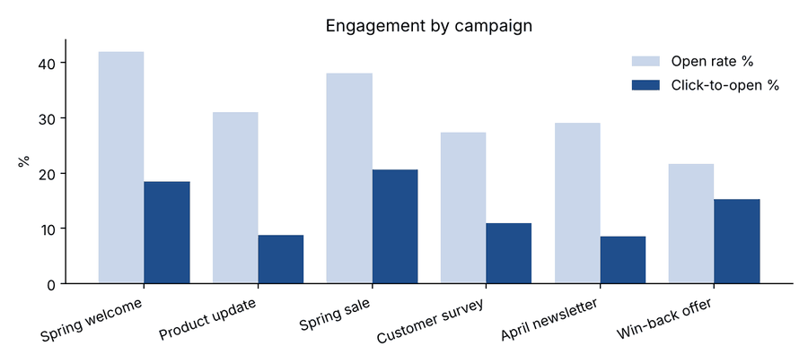

# Email Campaign ETL Pipeline


A Python ETL pipeline that turns messy email platform exports into a clean SQLite database and a campaign KPI report: open rate, click rate, click-to-open rate and unsubscribe rate per campaign.

I worked in marketing operations building Salesforce Marketing Cloud data extensions and emails. Campaign reporting from raw exports always had the same problems, so this project solves them in code.

> All data is synthetic, created by `generate_raw_data.py`. No client or subscriber data is used.

## What goes wrong with raw exports

- Dates arrive in three different formats in the same file
- The same subscriber appears as `a@x.com`, `A@X.COM` and ` a@x.com `
- People open an email several times, so raw opens overstate reach
- Email security scanners "click" every link within seconds of delivery

The last one matters most. On this dataset, scanner clicks push the click rate from 4.5% to 7.3%, which would make every campaign look better than it was.

## Pipeline

```text
raw/*.csv ──► extract ──► transform ──► load ──► report
              rename      parse dates    SQLite    docs/report.md
              columns     clean emails   tables +  docs/engagement.png
                          dedupe events  KPI view
                          drop bot clicks
```

| Step | File | What it does |
| --- | --- | --- |
| Extract | `etl/extract.py` | Reads the three exports and maps their column names to one standard |
| Transform | `etl/transform.py` | Parses mixed date formats, normalises emails, removes clicks within 10 seconds of send, keeps one event of each type per person |
| Load | `etl/load.py` | Writes clean tables to SQLite and builds a `campaign_kpis` view in SQL |
| Report | `pipeline.py` | Writes a markdown report and a chart |

## Results

Cleaning on the sample run removed 1,386 scanner clicks and 2,890 duplicate events.



| Campaign type | Avg open rate | Avg click-to-open | Avg unsubscribe |
| --- | --- | --- | --- |
| Promotional | 33.9% | 18.1% | 0.65% |
| Engagement | 27.4% | 10.9% | 0.41% |
| Newsletter | 30.1% | 8.7% | 0.17% |

What the numbers say: promotional emails get the most clicks per open, but the win-back offer has the highest unsubscribe rate (1.1%) and the lowest open rate (21.6%), so it is the one to rethink. Newsletters are opened but rarely clicked.

Full output: [`docs/report.md`](docs/report.md).

## Run it

```sh
pip install -r requirements.txt
python generate_raw_data.py   # creates raw/*.csv
python pipeline.py            # creates campaigns.db, docs/report.md, docs/engagement.png
pytest -q
```

The GitHub Actions workflow runs the tests and the full pipeline on every push.

## Licence

MIT
